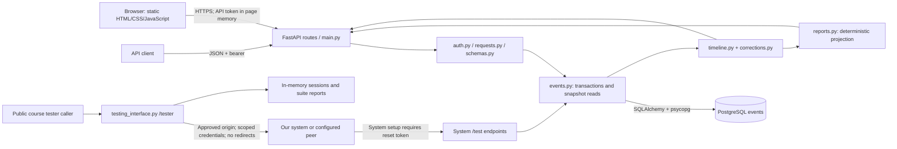
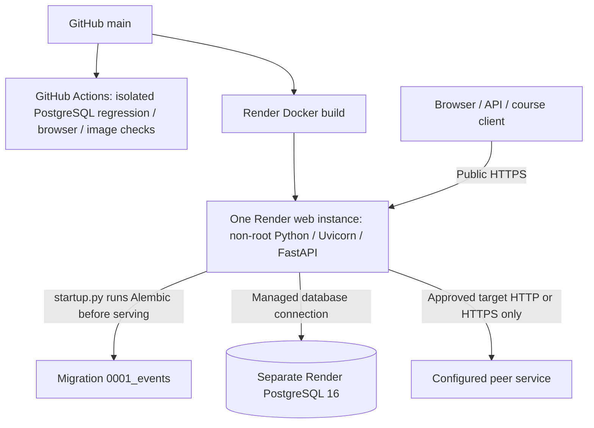
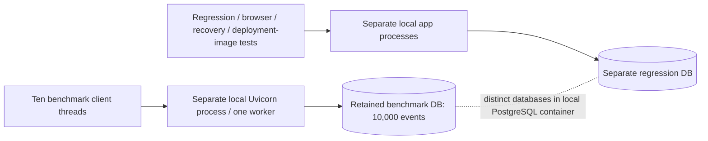

# Delivered architecture — Phase 5

This is the implemented architecture as of November 21, 2026. The project API is
OpenAPI 0.4.2; the testing-interface document is 1.2.0. See
[the model reconciliation](phase-5-models.md) for changes from the supplied Phase 2
model PDF and [delivery status](phase-5-delivery.md) for measured evidence/gaps.

## Components and trust boundaries

The browser, project API and hosted tester share one web service. They do not use
an external AI model, queue, separate report database, account service or second
frontend server. A correction adds a linked event and never overwrites its target.
Reports are rebuilt from one interaction snapshot, not stored as separate mutable
records. The API token grants access across interactions; there is no tenant model.

`ApplicationTiming` wraps `SafeErrorBoundary` and measures ASGI entry through
response-start, including assembly/serialization of buffered history/report bodies.
It emits `Server-Timing: traceai_app;dur=<milliseconds>`. It does not measure body
transfer or pre-ASGI infrastructure queues. Safe errors/logs exclude submitted
values, connection strings, bearer credentials and raw exception text.

Public tester setup/run can invoke configured reset credentials. Target approval
restricts destinations, but does not authenticate callers. This remains an
availability/data-reset risk for the synthetic classroom dataset; see
[the threat model](phase-5-security-review.md). Sessions are memory-only and vanish
on restart. Target approvals trust that origin's paths/DNS; they are not an IP
firewall or a defense against an operator-approved hostile domain.

## Deployment model

`render.yaml` requests free web/database plans and disables external database
access in the Blueprint. Actual provider plan, retention/expiration and future
availability must be checked by the owner; health does not expose those facts.
The web service serves `/`, `/assets`, `/health`, `/docs`, `/openapi.json`, the
five project operations, system `/test` endpoints and the `/tester` interface.
Container startup migrates; direct local `uvicorn` startup requires prior migration.

## Local validation topology

`.env.phase5` identifies the retained benchmark database; `.env.phase5-regression`
identifies the resetting regression database. Both are private/ignored. An ID prefix
alone does not isolate reset operations. The local client/app/database share the
machine, so measured local performance is not a Render resource benchmark.

## Dependency model

| Layer | Delivered dependency / role |
|---|---|
| Browser | Native HTML/CSS/JavaScript; no Node server or production JS framework |
| HTTP | FastAPI 0.143.1, Starlette 1.8.0, Uvicorn 0.54.0 |
| Validation/configuration | Pydantic 2.14.1, pydantic-settings 2.16.0 |
| Storage | SQLAlchemy 2.0.54, psycopg 3.3.6, PostgreSQL 16 |
| Migrations | Alembic 1.20.0 |
| Exact JSON numbers | simplejson 3.20.2 with Decimal support |
| Hosted evaluator | HTTPX 0.28.1, jsonschema 4.26.0, shared evaluator/fixtures |
| Development checks | pytest, OpenAPI validator, dependency compatibility, schema checks |
| Browser automation | Playwright 1.62.1 separately installed; not a runtime dependency |
| Delivery | Docker, GitHub Actions, Render web service and managed PostgreSQL |

Exact installed versions are pinned in `requirements-runtime.lock`,
`requirements-build.lock` and `requirements-dev.lock`. Dependency compatibility
passed; no vulnerability scan or independent penetration test is claimed.
