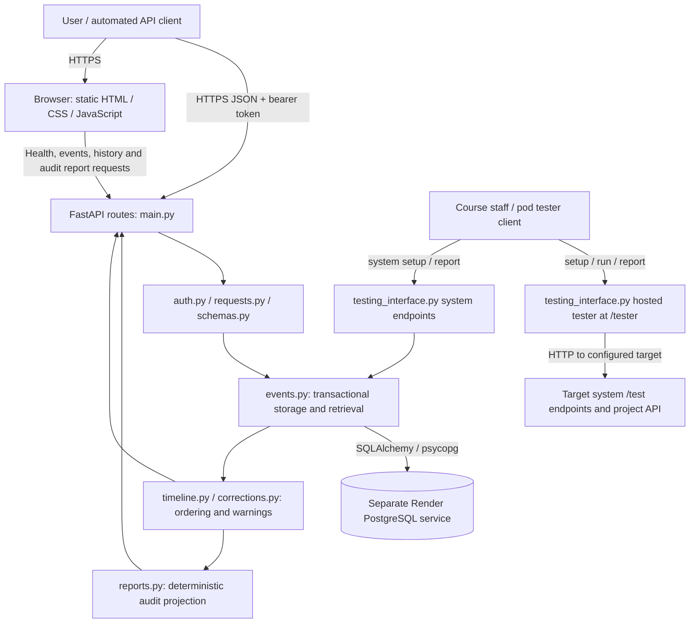

# Delivered architecture — Phase 4

This updates the Phase 2 architecture/data-flow model to reflect the implemented
browser, API analysis and hosted tester. Boxes name actual modules/services.

The Python service runs in a Docker container on Render; PostgreSQL is a separate
managed service. Accepted records are never replaced by correction events.
`SafeErrorBoundary` wraps HTTP handling, and `startup.py` migrates before serving.
The hosted tester reuses the independent evaluator and fixtures; its HTTP target
may be our service or an authorized peer. Test sessions/reports remain in memory.
No external AI model, queue, account system or separate report database is present.
