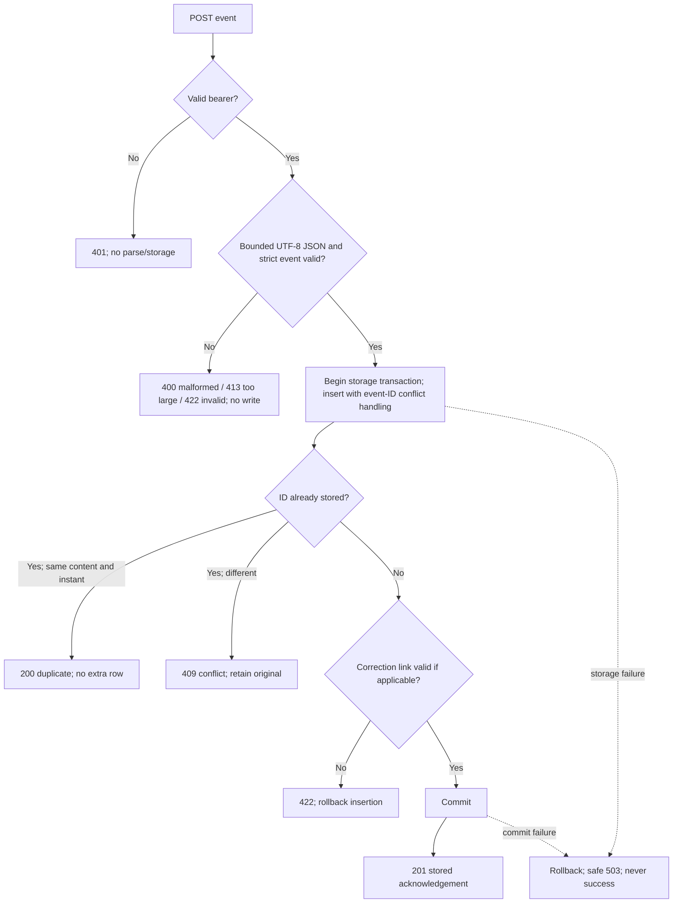
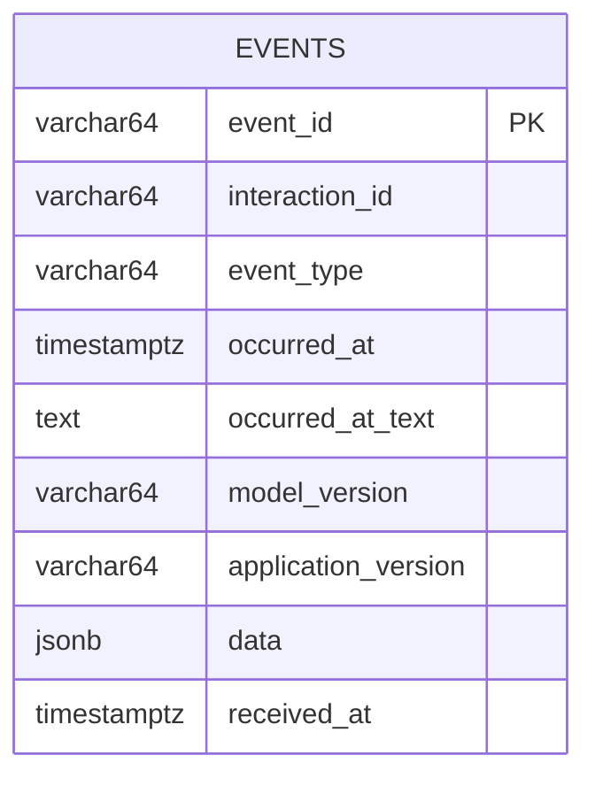
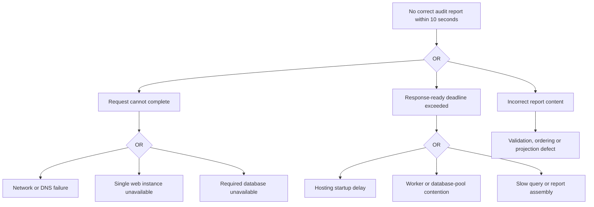

# Phase 5 engineering models and reconciliation

The supplied `Phase_2__3.2_Models.pdf` is an earlier design artifact. The delivered
baseline is the subsequently adopted OpenAPI 0.4.2/profile recorded in
[the pod specification](pod-specification.md) and November 1 cross-team evidence.
These models describe the current implementation; they do not assert new pod
approval of the proposed Phase 5 workload/timing interpretation.

## Reconciliation with the earlier model PDF

| Earlier model detail | Delivered baseline and consequence |
|---|---|
| Snake-case fields such as `event_id`, `timestamp`, `payload` | Camel-case `eventId`, `occurredAt`, `data`; see authored schema |
| 32 KB event limit | 65,536 raw UTF-8 request bytes; 65,537 is rejected |
| Model version conditional on AI output | `modelVersion` and `applicationVersion` required on every event |
| `user_input`, `ai_output`, `final_decision`, `interaction_ended` lifecycle | Six adopted event types listed below; no separate user-input/final-decision record type |
| Every repeated event ID rejected | Identical content is idempotent HTTP 200; changed content is HTTP 409 |
| `OPEN`, `FINALIZED_COMPLETE`, `FINALIZED_WITH_WARNINGS` status | `in_progress`, `completed`, `stopped`; warnings are a separate list |
| Mandatory final-decision/input and multiplicity warnings | Only implemented missing/order/correction rules below; no multiplicity warning |
| Timestamp order with ID tie-break | Retained; compares exact UTC instants, including sub-microsecond fractions |
| Late records trigger reevaluation | Retained through snapshot-based computation on each read |
| Corrections retain original evidence; reports avoid compliance verdicts | Retained and made explicit in links and report disclaimer |

This table makes differences visible rather than claiming literal compliance
with every earlier PDF rule. A new shared-behavior change still needs pod agreement.

## Model 1 — event processing workflow

Unsupported storage representations produce safe HTTP 422 rather than an
acknowledgement; operational SQL/storage failures produce 503 and unexpected
failures use the safe 500 boundary.

Correction targets must already exist in the same interaction and form an acyclic
link history. Timestamp order is not used to validate the link. Accepted records
are not updated; only explicit, elevated, enabled test reset deletes data.

## Model 2 — derived interaction state

```mermaid
stateDiagram-v2
  [*] --> in_progress: accepted nonterminal history
  [*] --> completed: first snapshot already ends in completion
  [*] --> stopped: first snapshot already ends in stop
  in_progress --> completed: last terminal in ordered history is interaction.completed
  in_progress --> stopped: last terminal in ordered history is interaction.stopped
  completed --> completed: late records; recompute warnings/report
  stopped --> stopped: late records; recompute warnings/report
  completed --> stopped: a later ordered stop becomes last terminal
  stopped --> completed: a later ordered completion becomes last terminal
```

This is a computed record view, not the state of an external AI system and not a
stored mutable status field. `completed` does not mean warning-free or compliant.
An interaction containing only a terminal event is already finalized and can have
missing-event warnings. Reset removes the record; a later lookup is 404.

## Model 3 — storage and event schema

There is one events table, with interactions derived by `interaction_id`; no
separate interaction/status/report table is required. The primary key is global.
A composite interaction/timestamp/event-ID index supports lookup, while exact
ordering uses retained timestamp text. Receipt time is internal, not a public
EventInput/StoredEvent field. API immutability is not a database-admin write ban.

| Public field | Delivered constraint |
|---|---|
| `eventId`, `interactionId` | Strings of 1–64 characters |
| `eventType` | `interaction.started`, `model.output_generated`, `review.completed`, `interaction.completed`, `interaction.stopped`, `record.corrected` |
| `occurredAt` | Valid RFC 3339 UTC text ending in `Z` or `+00:00`; exact fractional precision retained |
| `modelVersion`, `applicationVersion` | Required strings of 1–64 characters |
| `data` | Required JSON object; review/correction rules apply |

Reviews require nonblank `reviewerId`, supported action and nonblank reason.
Corrections require `correctsEventId` and nonblank reason. The authored
[JSON schema](../contracts/event.schema.json) and [OpenAPI](../contracts/openapi.json)
are the exact machine-readable contract.

## Model 4 — timeline/integrity rules

| Rule | Implemented observation |
|---|---|
| Ordering | Exact occurred-at instant, then event ID; receipt order is irrelevant |
| Missing prerequisite | Only finalized histories; start required, and output required when the history contains any completion or review |
| Out of order | A stage occurring strictly before the latest required predecessor produces `OUT_OF_ORDER_EVENT`; equal instants do not establish violation |
| Structural correction | Valid link produces `CORRECTED_EVENT`; original event stays present |
| Late arrival | Every read recomputes all rules from the stored snapshot |
| Multiple terminal records | Last terminal in ordered history determines completed/stopped status |

No user-input, final-decision, multiplicity, semantic AI-quality or legal-compliance
rule is implemented. Warning order is the implementation's deterministic traversal:
event-specific notices in timeline traversal, then applicable missing prerequisites.
It is not the earlier PDF's alphabetic warning-code sort.

## Model 5 — audit information projection

The report is generated from one history snapshot and includes `interactionId`,
`status`, event-count/first/last metadata, sorted unique model/application versions,
all ordered events, warnings, review actions, correction records with `linkValid`,
and the compliance disclaimer. Unchanged records yield identical report JSON;
there is no generated timestamp or report ID. GETs do not mutate records.

## Availability fault tree

This classroom scenario uses ten seconds to discuss availability; it is separate
from the measured AC-10 one-second/95% numerical target.

Assumptions: valid credentials, an existing interaction, one web route and one
required database; no redundant fallback route exists. Hence unavailability uses
OR, not the illustrative slide's redundant-route AND gate. A readiness check and
startup allowance before the demo mitigate the startup path only. Existing DB
timeouts and safe errors limit failure duration, not availability guarantees.
