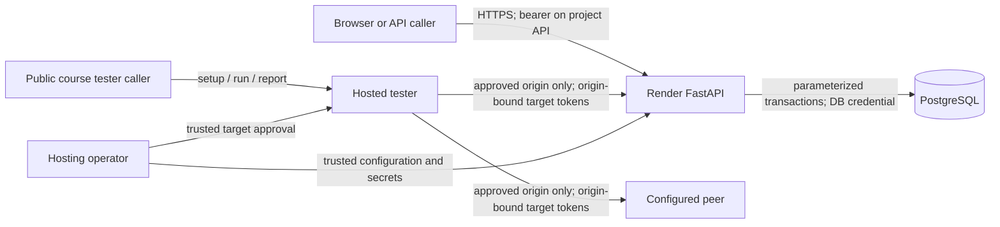

# Phase 5 chunk 2: threat model and security review

Reviewed November 18, 2026. Scope: the FastAPI application, browser frontend,
PostgreSQL writes/retrieval, protected reset and public course tester. This is a
source review with targeted automated checks, not an independent penetration test
or a claim of regulatory compliance. Capacity/performance acceptance remains for
chunks 3–4; final cross-team regression remains for chunk 5.

## Assets and trust boundaries

Assets are event history, correction/review links, audit reports, database and
bearer credentials, target credentials, synthetic test data and service capacity.
The intended deployment contains synthetic classroom records, not personal or
production data. An unauthenticated Internet caller is distinct from an ordinary
API-token holder, reset-token holder, configured peer service and hosting/DB
operator. The API token grants access to all interactions; this is not a tenant-
scoped authorization model.

Browser text, JSON fields, paths, session IDs and peer responses are untrusted.
Bearer and DB secrets remain server-side except the API token explicitly entered
in browser memory. Render TLS/ingress, operator configuration and the database
administrator are trusted infrastructure boundaries, outside application control.

## Findings and dispositions

| ID | Threat / consequence | Review result and control | Status |
|---|---|---|---|
| SEC-01 | Arbitrary tester URL causes server-side requests to internal/metadata services or unrelated hosts | Before this change, `valid_target` checked URL syntax but accepted arbitrary HTTP(S) origins. Added an origin allowlist checked before setup/network activity. Self origin, configured peer credential-map origins and an explicit JSON list are the only approvals. Missing/malformed configuration grants no extra targets. | Fixed in this chunk; high priority |
| SEC-02 | Target token sent to another host or through a redirect | Existing tokens are selected by exact origin, not supplied by callers; HTTP redirects are disabled. Added a redirect regression and peer-approval checks. | Existing control verified |
| SEC-03 | Unauthorized writes, reads or direct dataset reset | Project routes require constant-time bearer validation; ordinary token cannot reset. Reset also requires explicit enablement and confirmation. System setup requires reset token. | Existing control verified; public tester exception below |
| SEC-04 | Malformed/oversized JSON, SQL injection or partial writes corrupt records | Strict schemas, 65,536-byte streaming input limit, duplicate-key/nonfinite rejection, ORM bound parameters and transactional writes. Correction link checks and original-record preservation have integration coverage. | Existing controls verified within tested cases |
| SEC-05 | Exception, failed peer response or access-log output discloses credentials/data | Fixed errors, hidden SQL parameters, safe startup and redacted Uvicorn access logs. Canary tests exercise unexpected/storage/parser/peer failures. | Existing controls verified; provider logs outside scope |
| SEC-06 | Stored event/review text executes in browser | Rendering uses `textContent`; page CSP restricts scripts, frames and objects. Token stays in JS memory rather than browser storage. Existing frontend tests cover these controls. | Existing control reviewed and regression-tested |
| SEC-07 | Public tester used to erase approved synthetic data or consume CPU/memory | Public setup/run is a course interface. Approval limits destinations but does not authenticate callers. Sessions/reports remain memory-only and unbounded; runs have a deadline but there is no deployment-wide rate/admission limit. | Open availability risk; see operational limits |
| SEC-08 | Hosting/credential compromise or plaintext configured peer traffic | DB owner and hosting operator are trusted; bearer tokens have no expiry/revocation list. HTTP peers are allowed only by explicit origin approval. | Open deployment risk; see operational limits |

SEC-01 approvals trust all paths and DNS resolution for the configured origin.
The allowlist is not an IP-address firewall or DNS-rebinding defense against an
operator-approved hostile domain. Approve stable services controlled by the pod;
do not derive approvals from incoming requests. Scheme and explicit port must
match; redirects to even another approved origin are not followed automatically.
Existing configured peer origins continue to work. Extra public peers must be
approved by the operator before a course run. The project OpenAPI stays 0.4.2;
testing-interface documentation is 1.2.0 and documents setup's new 403 case.

## Verification

The committed [results summary](phase-5-security-results.json) records counts,
timestamps and SHA-256 hashes for the local evidence files.

- Full isolated PostgreSQL regression: **206 passed**, including eight new target
  policy/redirect cases. JUnit evidence: `reports/phase5-chunk2-pytest.xml`.
- Contract, schema parity, fixtures and Phase 5 plan invariants passed using
  `tools/validate_contract.py`; these do not establish benchmark acceptance.
- A real local HTTP self-test passed **126/126** checks using the separate `.env.phase5` database, never the
  shared Render or peer dataset. Results are recorded in
  `reports/phase5-chunk2-local-interface.json` and its raw reports; the denied
  metadata-origin request is recorded in `reports/phase5-chunk2-local-security.json`.
- Source review covered `auth.py`, `requests.py`, `config.py`, `safety.py`,
  `testing_interface.py`, the parameterized transactional storage path and browser
  rendering. No new dependency was introduced. A dependency vulnerability scan
  and independent external penetration test were not performed.

## Operational limits and next actions

Only synthetic, coordinated classroom testing is supported. Do not expose this
public tester to production records: it can invoke configured reset credentials
without authenticating its caller. A private deployment should restrict tester
routes at ingress or add agreed caller authentication before using sensitive data.
Rate limits, admission limits and session retention/expiry remain future hardening
work; the current deadline and body-size bounds do not solve distributed abuse.
Saving JSON reports promptly remains necessary because restarts erase sessions.

Prefer HTTPS peers. An approved HTTP origin can expose bearer tokens and records
on its network path; allowlisting does not encrypt them. Rotate externally shared
credentials in the hosting dashboard and update coordinated peer configuration;
this chunk did not change hosting secrets or claim they were rotated. Keep DB
connections/hosted access within provider controls, check database expiration and
export needed synthetic records. Expiration is still unconfirmed.

Use the isolated Phase 5 dataset for capacity/performance work next. Do not treat
this review or the passing functional suite as evidence for AC-10, measured source
coverage, completion of an external audit or absence of all vulnerabilities.
